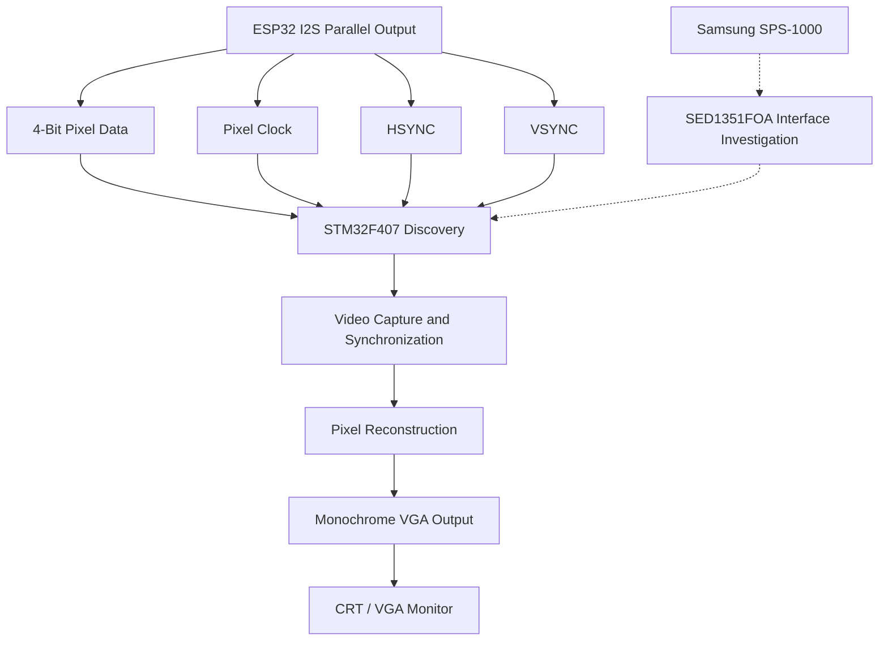

# STM32F407 Video Capture and VGA Reconstruction

### Reverse Engineering the Samsung SPS-1000 Display Pipeline

## Overview

This project explores whether an **STM32F407 Discovery board can capture a digital video stream, reconstruct its image, and output it to a standard VGA monitor**.

The ultimate goal is to investigate the display interface of the Samsung SPS-1000 cash register, which uses an SED1351FOA LCD controller, 
and determine whether its display data can be captured and reconstructed using an STM32F407.

Before connecting to the original hardware, an ESP32 is used as a controlled video signal generator. 
This allows the capture and reconstruction pipeline to be tested independently, reducing the risk of debugging several unknown hardware interfaces simultaneously.

## Project Pipeline

## Hardware Architecture

### 1. ESP32 — Digital Video Test Generator

The ESP32 generates a controlled digital video stream using an I2S-based parallel output implementation.

Signals used in the experiment:

- **4-bit parallel pixel data:** Carries the test image information.
- **PCLK:** Pixel clock used to coordinate data capture.
- **HSYNC:** Horizontal synchronization.
- **VSYNC:** Vertical synchronization.

The ESP32 provides a repeatable source of known video data. Its purpose is to validate the STM32 capture pipeline before using signals from the original cash register.

The implementation is based on the [ESP32-LCD-I2S project](https://github.com/har-in-air/ESP32-LCD-I2S), adapted for this experimental video source.

### 2. STM32F407 Discovery — Capture and Reconstruction

The STM32F407 is the central processing unit of the project.

Its intended responsibilities are:

1. Capture the incoming 4-bit pixel stream.
2. Detect horizontal and vertical synchronization.
3. Identify the beginning of each line and frame.
4. Reconstruct the pixel image.
5. Generate a monochrome VGA output.

The exact capture method and timing depend on the input clock, GPIO configuration, timer peripherals, DMA configuration, and synchronization logic.

A major part of the experiment is ensuring that the incoming video stream remains synchronized with the reconstructed VGA frame.

### 3. VGA Output — Visual Verification

The STM32F407 generates a monochrome VGA signal to display the reconstructed image on a CRT or VGA-compatible monitor.

This provides a direct visual way to evaluate the capture process.

Test results can reveal issues such as:

- Moving horizontal black lines.
- Vertical image instability.
- Incorrect line alignment.
- Pixel corruption.
- Frame synchronization errors.

These symptoms help distinguish capture timing problems from VGA output timing problems.

## DMA and Synchronization Experiments

One important experiment compares continuous circular DMA operation with a one-shot DMA transfer.

During testing, the reconstructed image showed a moving black line. 
Initial experiments suggested that synchronization behavior, including the VSYNC waveform, could be contributing to the instability.

Changing the ESP32 transmission from continuous circular DMA to a one-shot transfer made the image substantially more stable.

This observation motivates further investigation into:

- VSYNC pulse width and polarity.
- The alignment of DMA buffer boundaries with frame boundaries.
- The relationship between PCLK, HSYNC, and VSYNC.
- STM32 line-counter reset behavior.
- Consistent capture of complete frames.

The root cause has not yet been conclusively established.

## Target Hardware: Samsung SPS-1000

The long-term objective is to investigate the display subsystem of the Samsung SPS-1000 cash register.

The project focuses on the SED1351FOA LCD controller and the possibility of using the STM32F407 to capture or reconstruct the display data.

Before implementing the target interface, the following must be established from the actual hardware and applicable documentation:

- Pixel-data bus width and format.
- Interface direction and signal assignments.
- Pixel clock or equivalent transfer timing.
- Horizontal and vertical synchronization behavior, if present.
- Electrical voltage levels.
- Framebuffer or memory-interface requirements, if applicable.

The ESP32 test generator is not intended to duplicate the SED1351FOA interface exactly. 
It is a development tool for validating the STM32 capture and reconstruction stages independently.

## Development Roadmap

- [x] Generate a controlled 4-bit parallel video stream with the ESP32.
- [x] Generate monochrome VGA output using the STM32F407.
- [x] Connect the ESP32 test source to the STM32F407 capture setup.
- [x] Observe the reconstructed image on a VGA monitor.
- [x] Investigate instability associated with synchronization and DMA operation.
- [ ] Achieve consistently stable image reconstruction.
- [ ] Verify pixel sampling and frame-boundary alignment.
- [ ] Characterize the Samsung SPS-1000 display interface.
- [ ] Determine a suitable STM32F407 capture architecture for the target hardware.
- [ ] Attempt display reconstruction using signals from the SED1351FOA subsystem.

## Project Status

**Experimental proof of concept — in development.**

The ESP32-to-STM32F407 pipeline has produced a visible monochrome VGA image. 
Experiments have also shown that changing the DMA transmission strategy can substantially improve image stability.

The remaining work is to establish reliable synchronization and validate the interface requirements of the original Samsung SPS-1000 hardware.

## Project Goal

The goal is to determine whether an STM32F407 can serve as a practical bridge between a digital display source and a reconstructed VGA image, 
and whether this approach can be adapted to investigate and recover the Samsung SPS-1000's display output.

This project combines embedded programming, DMA-based data acquisition, digital video timing, VGA generation, and hardware reverse engineering.

**The ESP32 provides the known test signal. The STM32F407 performs the reconstruction. The Samsung SPS-1000 is the eventual target.**

